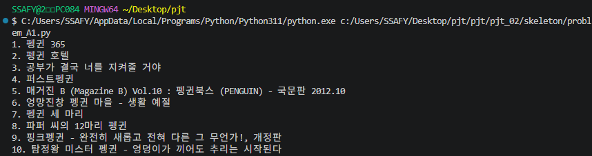
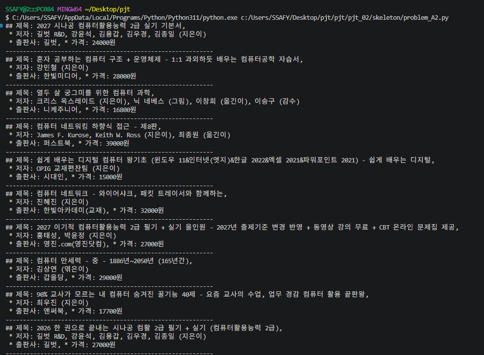
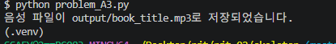

# 02-pjt : AI 기반 도서 분석과 창작 지원 통합 솔루션 서비스

> SSAFY 16기 Python 관통 프로젝트 2회차
> 진행일자: 2026.09.04
> 과제 그룹: 최주희, 피윤아

---

## 1. 프로젝트 개요

알라딘 API를 통해 도서 데이터를 직접 수집하고, 수집한 데이터를 원하는 형태로 가공·저장하며, gTTS를 활용해 음성 파일로 변환하는 실습 프로젝트다.

## 2. 개발 환경

| 항목 | 내용 |
|---|---|
| 언어 | Python 3.11+ |
| 에디터 | Visual Studio Code |
| 주요 라이브러리 | `requests`, `python-dotenv`, `gTTS`, `json`, `pathlib` |

## 3. 프로젝트 구조

```
02-pjt/
├── problem_A1.py
├── problem_A2.py
├── problem_A3.py
├── output/
│   ├── computer_books.txt
│   └── book_title.mp3
├── .env
├── requirements.txt
└── README.md
```

## 4. 요구사항별 구현 내용

### 4.1 problem_A1.py — API 요청 함수 작성하기

- **요구사항 번호**: F201, F202, F203, F204
- **구현 함수**: `fetch_books`

| 요구사항 | 내용 |
|---|---|
| F201 (민감 정보 관리) | API Key를 `.env` 파일에 저장하고 `dotenv`로 불러와 코드에서 분리 |
| F202 (API 호출) | `requests`로 제목 기준 도서 검색 요청 전송 |
| F203 (데이터 변환) | 응답 데이터를 JSON 형식으로 파싱 |
| F204 (데이터 변환) | 함수 실행 결과로 필요한 형태 반환 |

- **실행 방법**
  ```bash
  python problem_A1.py
  ```
- **동작 설명**: `fetch_books` 함수로 "펭귄" 키워드 도서 10권을 검색하고, 번호를 붙여 제목을 출력합니다.
- **실행 결과 예시**
  

- **어려웠던 점 / 배운 점**
  - env의 중요성을 더 잘 알 수 있었다. API키를 'env' 파일에 꼭 올려야한다는 것을 다시 리마인드 할 수 있었고, 데이터를 변환하는 방법을 배웠다. 
  또한 실행 결과를 잘 만들기 위해 중간 중간 고치는 부분이 많았어서 공부를 더 해야겠다고 생각한다. 

---

### 4.2 problem_A2.py — 도서 데이터 가공 및 저장

- **요구사항 번호**: F205
- **구현 함수**: `save_books_to_file`

| 요구사항 | 내용 |
|---|---|
| F205 (데이터 저장) | "컴퓨터" 키워드로 검색한 도서 정보 중 제목/저자/출판사/가격(정가, `priceStandard`)만 마크다운 형식으로 정리하여 파일 저장 |

- **세부 구현**
  - `fetch_books` 함수 재사용
  - `output` 폴더 생성 시 이미 존재해도 에러가 발생하지 않도록 처리 (`os.makedirs(..., exist_ok=True)` 등)
  - 결과는 `output/computer_books.txt`로 저장

- **실행 방법**
  ```bash
  python problem_A2.py
  ```
- **실행 결과 예시**
 
 
- **어려웠던 점 / 배운 점**
  - 저장된 파일을 읽어 콘솔에 출력하는 과정이 오류가 많이 났었는데, 그 과정을 팀원과 상의하며 서로 보완하고 공부가 되었다. 

---

### 4.3 problem_A3.py — TTS 파일 생성하기

- **요구사항 번호**: F206
- **구현 함수**: `fetch_book_title`, `create_tts_file`

| 요구사항 | 내용 |
|---|---|
| F206 (음성 파일 생성) | 검색된 도서의 첫 번째 제목을 gTTS로 음성 변환하여 저장 |

- **세부 구현**
  - `fetch_book_title`: 주어진 키워드로 알라딘 API에서 도서를 검색해 제목 반환
  - `create_tts_file`: `fetch_book_title` 호출 결과를 gTTS로 변환하여 `output/book_title.mp3`로 저장

- **실행 방법**
  ```bash
  python problem_A3.py
  ```
- **실행 결과 예시**
  ```
  음성 파일이 output/book_title.mp3로 저장되었습니다.
  ```



- **어려웠던 점 / 배운 점**
  - 초반에 api 키를 env에 작성한 후 MY_TTBKEY로 변환해 코드에 작성해야하는데 바로 api키를 MY_TTBKEY에 넣어 어려움을 느꼈다.
  이 부분은 앞으로도 신경써서 해결해야 할 것 같다.  
  TTS 파일 생성 함수 정의하고 요청대로 자료를 정리하고 음성 파일을 생성하는 것이 어려웠지만 재미있었다. 

## 5. 실행 전 준비

1. 가상환경 생성 및 활성화
2. 의존성 설치
   ```bash
   pip install -r requirements.txt
   ```
3. `.env` 파일에 알라딘 API 키 등록
   ```
   API_KEY=발급받은_API_KEY
   ```

## 6. 회고

- **새로 배운 점**: [작성 예정]
- **어려웠던 점과 해결 과정**: [작성 예정]
- **향후 개선하고 싶은 부분**: [작성 예정]
